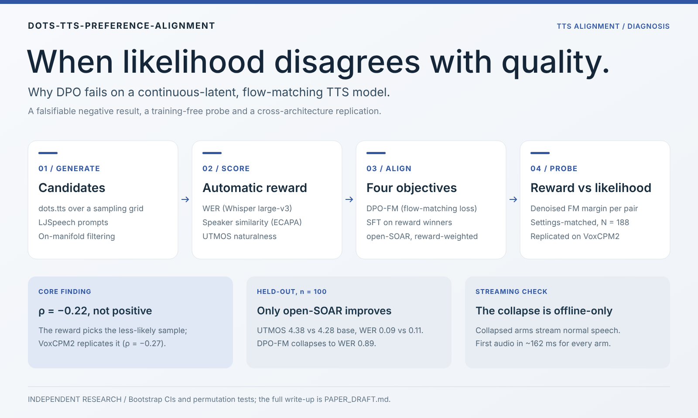
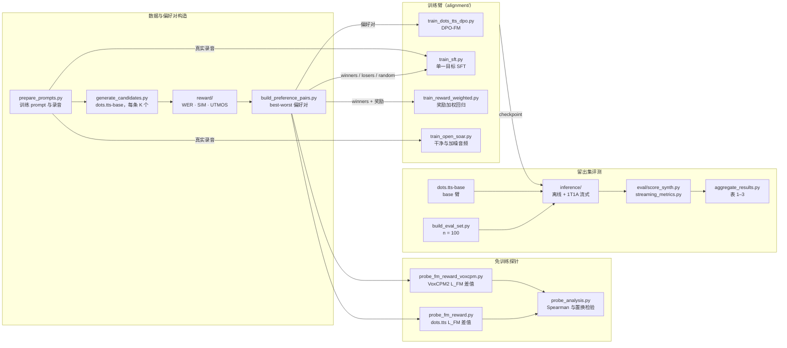

<div align="center">

# 当似然与质量背道而驰

[English](README.md) · **简体中文**

**一份警示性诊断：Direct Preference Optimization 用在连续 latent 流匹配 TTS 上会出什么问题。**


[](https://www.ccao2679.com/research/#dots-tts-preference-alignment)



</div>


> **研究问题。** 能不能用最直接的办法对齐一个现代连续 latent 文本转语音模型——生成候选、用自动指标打分、再用 DPO 朝赢家方向训练？
>
> **结论（本项目）。** 不能——而真正有意思的是*为什么*。自动指标给出的奖励会系统性地偏向模型认为**更不可能**的那个候选，于是顺理成章移植过来的 DPO 朝着错误方向优化，模型随之退化。我用留出集基准、一个免训练的机理探针和一次跨架构复现证明了这一点，并进一步给出*确实*有效的对齐路线。

一个**独立完成的端到端研究项目**：数据 → 候选 → 奖励 → 偏好对 → 四种训练目标 → 离线与流式评测 → 统计分析 → 论文。核心结论是一个**可证伪的负面／诊断性结果**，而不是项目一开始希望得到的结果。

> 📄 论文：[`PAPER_DRAFT.md`](PAPER_DRAFT.md) · 🧪 发现与结果：[`docs/`](docs/) · 🧭 决策日志／12 视角红队评审：[`docs/02-DECISIONS.md`](docs/02-DECISIONS.md) · 📚 核验过的参考文献：[`refs.bib`](refs.bib) · 🗄️ 详细项目记录（中文）：[`docs/10-项目说明-原始详细中文版-存档.md`](docs/10-项目说明-原始详细中文版-存档.md)
>
> 许可证 **Apache-2.0**（代码）· 研究对象：**dots.tts**（2B，flow-matching，Apache-2.0）+ **VoxCPM2**（2B，diffusion-AR，OpenBMB）

---

<!-- problem-framing:start -->

## 问题与依据

> **在相同数据与训练预算下，基于 FM surrogate 的偏好训练，能否在独立质量评价中超过 winner-only SFT，并在生成条件变化后保持收益？**

**为什么值得解决：** 连续语音模型的后训练需要把偏好信号转化为可听见的生成改善。只有训练损失下降或自动评分提高，还不足以判断方法是否适合实际合成。

**核心矛盾：** 自动指标、训练 surrogate 与真实生成质量可能不一致；不同提示和解码条件也可能改变观察到的退化。FM loss 不自动等于真实 likelihood，与奖励的相关性不能单独证明训练失败的因果机制。

[完整问题与验证计划](PROBLEM.zh.md) · [English](PROBLEM.md)

<!-- problem-framing:end -->

## TL;DR

连续 latent TTS（在连续音频 latent 上做流匹配——**没有离散音频 token**）没有原生的偏好对齐方案，因为 DPO 需要 token 的对数概率，而这类模型根本不产生它。*顺理成章*的补救办法是 **DPO-FM**：仿照 Diffusion-DPO，用流匹配损失 `L_FM` 充当似然代理。我检验了它唯一的承重假设——*自动指标奖励偏好的，是不是模型认为更可能的那个候选？*——结果恰恰**相反**：

- **奖励偏好与模型自身的流似然呈单调*负相关***（settings-matched Spearman **ρ = −0.216**，N = 188，在质量差最大的偏好对上更强）。奖励系统性地挑中每一对里**偏离流形（off-manifold）**的那一个。
- 这**不是** `L_FM` 作为似然代理失效（与似然一致的偏好能把它优化到饱和）——失效的是**奖励↔似然的耦合**。
- 留出集（n = 100）上：**只有与似然一致的 on-manifold 路线带来提升**；所有朝奖励选出的自生成目标训练的臂——DPO-FM *以及*朴素的 SFT-on-winners——全部**崩溃**。
- 崩溃**只出现在特定解码路径上**：同样的 checkpoint 在生产用的 1T1A 解码下**流式输出完全正常的语音**——这是生成阶段的伪影，不是模型坏了。
- 该诊断在**第二个独立构建的架构**上**无混杂地复现**（VoxCPM2，diffusion-AR；settings-matched ρ = −0.266）→ 跨 **N = 2** 种连续 latent 实现的架构级证据。

---

## 架构



从左往右读：候选 → 奖励 → 偏好对这条链同时供给各训练臂和免训练探针；每个臂（连同未训练的 base）都在同一个留出集上合成，并用与奖励阶段相同的 WER/SIM/UTMOS 后端打分。所有臂都从 dots.tts-base 微调，训练由 `run_train_all.sh` 调度，合成与打分由 `ablation/run_matrix.py` 驱动。

---

## 为什么重要

偏好对齐（RLHF/DPO）是 LLM 后训练的默认工具，把它搬到语音上是很自然的一步。本项目表明，这种直接移植存在一个**被标准指标掩盖的静默失效模式**：训练"成功"了（损失从不发散），模型却在一部分输入上于生成时退化。交付物是**一个机理 + 一个能在投入一个 GPU 周之前就先跑的廉价诊断**——先在留出的偏好对上测出似然↔奖励耦合的符号。

对生产语音系统的具体启示：
- **奖励设计 ≠ 奖励优化。** 当奖励偏好 off-manifold（例如 guidance 过强）的样本时，*怎么重新分配 WER/说话人/UTMOS 三项的权重都修不好*——三个轴都与似然负相关。
- **离线评测可能误导对流式的判断。** 这里离线的灾难性崩溃*没有*迁移到逐 token 流式——与部署相关的那条路径是正常的。只测一条解码路径，两个方向上都会得出错误结论。
- **真正有效的做法：** 朝真实目标的免奖励自校正（open-SOAR），或以真实录音为锚、*不基于似然*的奖励加权目标。

---

## 主要结果

### 1. 留出集基准（离线，n = 100 LJSpeech，bootstrap 95% CI）

WER ↓（Whisper-large-v3）· SIM ↑（ECAPA-TDNN）· UTMOS ↑（自然度 MOS 预测器）

| 臂 | WER ↓ | SIM ↑ | UTMOS ↑ | n | 结论 |
|---|---|---|---|---|---|
| `base`（dots.tts） | 0.112 | 0.878 | 4.278 | 100 | 参照 |
| **`open_soar`** | 0.094 | 0.850 | **4.380** | 100 | **唯一有提升的臂**——UTMOS 最佳，WER ≈ base |
| `dpo_weronly` | 0.110 | 0.856 | 4.055 | 100 | ≈ base（仅 WER，影响轻微） |
| `sft`（on winners） | **0.556** | 0.629 | 3.788 | 100 | **崩溃**——推翻了"安全对照"的预期 |
| `dpo_multiobj` | **0.890** | 0.341 | 2.719 | **75** | **灾难性崩溃 + 25% 生成失败** |

> `dpo_multiobj` 在 **25/100** 条 prompt 上生成失败（立即 EOS）；它的 WER 只统计成功合成的 75 条——**失败率与 WER 并列报告**，绝不被 WER 掩盖。

### 2. 崩溃程度随 SFT 目标的"off-manifold 程度"单调变化（受控梯度）

数据量、流程和步数预算全部相同——只换训练目标：

| SFT 目标 | WER ↓ | UTMOS ↑ | |
|---|---|---|---|
| `sft_groundtruth` — **真实录音（on-manifold）** | **0.087** | 4.337 | **最佳，优于 base** |
| `sft_random` — 随机候选（居中） | 0.138 | 4.035 | 轻微 |
| `sft` — 奖励*赢家*（最 off-manifold） | 0.556 | 3.788 | 崩溃 |
| `sft_losers` — 奖励*输家*（off-manifold） | 0.569 | 3.952 | 崩溃 |

→ 毒药是**目标分布（off-manifold），而不是 DPO 的对比本身**——哪怕是朴素 SFT，只要指向 off-manifold 目标也会崩溃。这也化解了审稿人最常提的混杂因素（小数据 SFT 本身就不稳定）：在相同数据量下，*on-manifold* 目标**不会**崩溃。

### 3. 机理——免训练的似然↔奖励探针（核心发现）

在全部 **N = 188** 个偏好对上，我测量**去噪后的流匹配 margin**（`L_FM(loser) − L_FM(winner)`，当且仅当 winner 拟合得更好、也就是符合 DPO-FM 的假设时为正），并与奖励差做相关：

- **头条结果（settings-matched）：Spearman ρ = −0.216**（ρ² ≈ 4.7%），95% CI 不含 0；在高质量差分层上**更强**（前 50% −0.318，前 25% −0.533）。
- 并列报告（不作头条）：**Pearson −0.489**，明确标注为*被高杠杆点放大*的线性系数——删掉一个高杠杆偏好对，它的符号就会翻转，而秩统计量保持稳定。优先报告稳健统计量是刻意的选择。
- **每一个奖励轴**在奖励对齐的方向上都呈负相关：−WER −0.52，SIM −0.77，UTMOS −0.72。SIM/UTMOS 比 WER *更强* → 不能靠"调奖励权重"解决，只能放弃把 `L_FM` 当奖励。
- **结论：** `L_FM` 是有效的*似然*代理，但**不是有效的隐式奖励**——这是方法本身的边界。

### 4. 跨架构复现（回应"N = 1"的泛化质疑）

*同一批* dots 生成的偏好对，改用 **VoxCPM2 自己的**训练 FM 损失打分（独立团队；diffusion-AR，而 dots 是 flow-matching）：

| 设计 | Spearman ρ | |
|---|---|---|
| 有混杂的网格池（生成设置各不相同） | −0.087（不显著） | 混杂*掩盖*了效应——作为溯源信息报告 |
| **Settings-matched**（设置差 ≡ 0） | **−0.266**（p_perm = 3×10⁻⁴） | 效应**重新出现且显著** |

→ 这是在**两个独立的连续 latent 实现**上成立的架构级结论，而不是 dots.tts 的个例。范围如实限定在 N = 2——*不是*"所有 TTS"。

### 5. 流式实测检验

在生产用的 1T1A 流式下：**首包音频延迟（time-to-first-audio）基本不变（所有臂约 162 ms）**——对齐不增加延迟。更关键的是，崩溃臂的离线失效**并没有迁移过来**——它们在流式下完整输出 n = 100 条正常语音，流式 WER 为 0.212 / 0.134，**UTMOS 4.283 / 4.406 ≈ base 4.326**——证实崩溃是**离线解码路径的伪影**，而不是模型受损。

### 6. 如实报告的负面结果：没有复现 reward hacking

预先登记的 WER-only 对比多目标的 reward hacking 实验**没有复现出 hacking**——两个 WER-only 臂都没有拿到最低 WER。把它作为负面结果报告而不是埋掉，是因为错配的目标根本没有进入会出现 hacking 的区间。

---

## 为什么说这是*研究*，而不只是跑了一次实验

- **可证伪的问题设定。** 一个承重前提，开篇即明确陈述、直接检验，并被**推翻**——整篇论文围绕这次推翻展开。
- **统计严谨。** 每个差值都给出 bootstrap 95% CI；**优先报告 Spearman，而不是被杠杆放大的 Pearson**；置换检验考虑了说话人聚类；去衰减分析表明所报系数是*保守的下界*；预先设定的差值分层作为稳健性检验。
- **从设计上消除混杂。** 头条结论不是偏相关——而是一个 **settings-matched 探针**：winner/loser 在完全相同的生成设置下配对，*从构造上*去掉了整个采样网格。
- **科学诚实。** 一个被撤回的过度结论（n = 24 的预实验在扩大规模后回落到随机水平，已公开报告）；范围限定在"两种架构，而非所有 TTS"；流式证据出来后，明确**不再**称模型"坏了"。
- **对抗式自我审查。** 12 视角的内部红队评审（[`docs/02-DECISIONS.md`](docs/02-DECISIONS.md)），以及一份经过核验、逐条 curl 检查的参考文献（[`refs.bib`](refs.bib)——34 条，每个 arXiv id 都做了标题匹配）。
- **完整掌控整个技术栈**，从语料准备到最终成文。

---

## 流程与目录结构

```
data → candidates → reward scoring → preference pairs → alignment → evaluation → analysis
```

| 路径 | 内容 |
|---|---|
| [`alignment/`](alignment/) | DPO-FM 目标、open-SOAR、奖励加权训练；`L_FM`↔奖励探针（dots.tts + VoxCPM2）、置换／杠杆分析 |
| [`reward/`](reward/) | WER / 说话人 SIM / UTMOS 打分器（批量、带缓存） |
| [`pairs/`](pairs/) | best-worst 偏好对构造、on-manifold 过滤、settings-matched 配对 |
| [`candidates/`](candidates/) | 在采样网格上生成候选 |
| [`inference/`](inference/) | 离线 + 1T1A 流式合成 |
| [`ablation/`](ablation/) · [`results/`](results/) | 实验矩阵、结果汇总、绘图 |
| `run_x{4,5,6,7,8,10,14}.sh` | 一条命令跑完一个实验的封装脚本（自检 → 运行 → 分析 → 归档） |
| [`docs/`](docs/) | 发现、决策日志（ADR）、结果表、踩坑记录、引用／arXiv 核查清单、存档的项目记录 |
| [`PAPER_DRAFT.md`](PAPER_DRAFT.md) | 完整论文稿 |

### 复现

```bash
bash env/setup_env.sh                 # clone dots.tts/VoxCPM2, install deps, fetch SV checkpoint
bash run_full_dataprep.sh             # corpus → candidates → reward → preference pairs
bash run_train_all.sh 0 open_soar dpo_multiobj dpo_weronly sft   # train arms (GPU)
python alignment/probe_fm_reward.py --pairs pairs/out/pairs_best_worst.jsonl --n 188 --k 16
python results/aggregate_results.py   # Tables 1–3
```

训练和评测需要 NVIDIA GPU；探针只做前向计算。

### 数据可得性

代码、分析脚本以及全部结果**表格／数字**（见 [`docs/`](docs/) 和 [`PAPER_DRAFT.md`](PAPER_DRAFT.md)）都纳入了版本控制。体积大或能轻松重新生成的产物——模型 checkpoint、生成的音频、大部分逐对 CSV、日志——**按设计被 git 忽略**，可以用上面的脚本复现；原始运行输出保存在 GPU 主机上。例外是四个探针文件 `alignment/out/probe_per_pair*.csv`、`results/out/` 中的运行汇总和 `ablation/ledger.jsonl`：报告中的数字由它们计算得出，因此纳入了版本控制。

---

## 关于

关于连续 latent 语音生成中偏好对齐的独立研究——涵盖现代 TTS 架构（flow-matching 与 diffusion-AR）、DPO/RLHF 理论以及严格的语音评测。从设计、实现到分析，全部端到端独立完成。

*本项目作为申请 AI Research Scientist 职位的作品集而准备。完整的中文项目记录（实验叙述与决策历史）存档于 [`docs/10-项目说明-原始详细中文版-存档.md`](docs/10-项目说明-原始详细中文版-存档.md)。欢迎通过 Issues 提问。*
